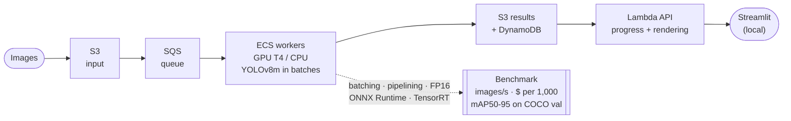
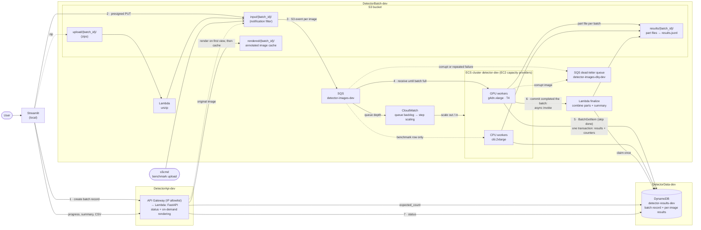
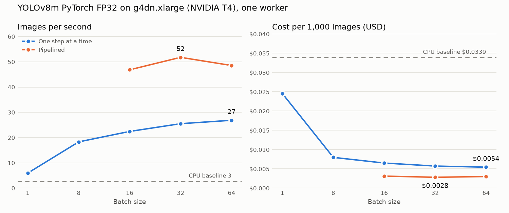
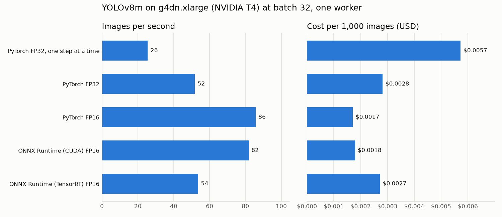

# Batch object detection on AWS

Runs YOLOv8m object detection over large image sets on AWS, as cheaply and quickly as possible. Images land in S3 and queue up in SQS. ECS workers on GPU (and CPU) instances process them in batches and write results to S3 and DynamoDB. A small API on Lambda reports progress and renders annotated images on demand, and a local Streamlit app sits on top of the API.

The project measures what batching, pipelining, FP16, ONNX Runtime and TensorRT are worth on a T4 GPU (`g4dn.xlarge`), in images per second and dollars per 1,000 images. Every number comes from the full COCO 2017 validation set (5,000 images), with accuracy checked as mAP50-95.



**Status:** complete. The one open item is TensorRT throughput, left for a later milestone ([below](#open-issue-tensorrt-throughput)).

- **Set it up in your own AWS account:** [docs/SETUP.md](docs/SETUP.md)
- **Design and the reasons behind each choice:** [docs/design.md](docs/design.md)
- **Full benchmark report:** [docs/benchmark.md](docs/benchmark.md)

## Headline results

- **Best setup:** pipelined PyTorch FP16 at batch 32 processes **85.7 images/s for $0.0017 per 1,000 images** on one `g4dn.xlarge`. Its mAP50-95 is 0.5021, against 0.5026 for FP32 (the published YOLOv8m value is 0.502). It's the GPU service's default.
- **GPU vs. CPU:** about **30× faster and 20× cheaper** per image than an unoptimized CPU baseline at a similar hourly price (`c6i.2xlarge`: 2.8 images/s, $0.0339 per 1,000).
- **Pipelining beat batch size.** Larger batches took FP32 from 6 to 27 images/s, but the GPU was still only 49% busy. Overlapping download/decode, inference and writes in separate threads doubled that to 52 images/s with the GPU 93% busy.
- **TensorRT is the open issue.** It has the fastest model execution (5.4 ms per image vs. 10 ms for PyTorch FP16) but the slowest end-to-end FP16 result (53.7 images/s), because image loading slows down while it runs.

## Architecture



**One batch, start to finish** (the numbers match the diagram):

1. **Create the batch.** The batch record (with `expected_count`) is written first, so progress and completion are always well defined.
2. **Upload.** Images go straight to `input/{batch_id}/` through presigned URLs, or as a zip to `upload/`, which a Lambda function extracts. Large sets go up with s5cmd.
3. **Queue.** S3 sends one SQS message per image. Only `input/` sends notifications, so files the system writes itself never queue work.
4. **Batch.** A GPU worker long-polls SQS until it has a full batch (32 by default) or a short wait runs out. The queue backlog drives ECS step scaling, from 0 workers up to the configured maximum.
5. **Infer and commit.** The worker drops images that already have results, runs the model, writes one part file to S3 and commits every result plus the batch counters in one DynamoDB transaction. Then it deletes only the messages it finished. A corrupt image gets a `failed` record and goes to the dead-letter queue; temporary errors are retried.
6. **Finalize.** The worker whose commit completes the batch invokes the finalize function. Exactly once, it merges the part files into `results.jsonl` and writes `summary.json`.
7. **Status and rendering.** The API reports progress and the summary. It renders annotated images only when someone views them, then caches them in `rendered/`.

**Reliability by construction:**
- **Idempotent re-runs:** a duplicate S3 event or a re-upload skips finished images.
- **Exactly-once counting:** results are conditional puts, committed in the same transaction as the counter update.
- **Bad input stays contained:** one corrupt file fails only itself, and its message goes to the dead-letter queue.
- **Graceful shutdown:** on SIGTERM a worker finishes the batches it has in flight before exiting.
- **Scale to zero:** workers start at 0 and return to 0 when the queue is empty. There's no NAT gateway, so an idle deployment costs only storage.

| Stack | Holds |
| --- | --- |
| `DetectorData-<env>` | DynamoDB results table |
| `DetectorBatch-<env>` | S3 bucket, queue and dead-letter queue, VPC (public subnets, no NAT, S3/DynamoDB gateway endpoints), ECS cluster with GPU and CPU capacity providers, worker services and scaling, the finalize and unzip functions |
| `DetectorApi-<env>` | FastAPI on Lambda behind an API Gateway REST API that only allows `api_allowed_cidrs` |
| `DetectorCi-<env>` | GitHub Actions OIDC roles and the build-cache ECR repo (deployed once, by hand) |

CI/CD runs on GitHub Actions and authenticates to AWS through OIDC, with no stored keys. Pull requests run lint, tests, `cdk synth` and a `cdk diff` posted to the PR; merged PRs into `develop` deploy.

## Benchmark results

Method: one worker on one instance per row, YOLOv8m on all 5,000 COCO val2017 images, with the queue filled before the worker starts. Each row is timed from the first message received to the last result written, so instance start, image pull and model warm-up are excluded. Cost counts On-Demand instance time only (us-west-2). The full table, the per-stage timing table and the method notes are in [docs/benchmark.md](docs/benchmark.md).

| Setup | Precision | Batch | Images/s | Time for 5,000 | Cost per 1,000 | GPU busy | mAP50-95 |
| --- | --- | --- | --- | --- | --- | --- | --- |
| CPU `c6i.2xlarge`, PyTorch (unoptimized baseline) | FP32 | 1 | 2.8 | 29 min 57 s | $0.0339 | — | 0.5026 |
| GPU `g4dn.xlarge`, PyTorch | FP32 | 1 | 6.0 | 14 min 00 s | $0.0245 | 11% | 0.5026 |
| GPU, PyTorch | FP32 | 64 | 26.9 | 3 min 06 s | $0.0054 | 49% | 0.5026 |
| GPU, PyTorch, pipelined | FP32 | 32 | 51.8 | 1 min 37 s | $0.0028 | 93% | 0.5026 |
| **GPU, PyTorch, pipelined** | **FP16** | **32** | **85.7** | **58 s** | **$0.0017** | 83% | 0.5021 |
| GPU, ONNX Runtime (CUDA), pipelined | FP16 | 32 | 81.8 | 1 min 01 s | $0.0018 | 81% | 0.5021 |
| GPU, ONNX Runtime (TensorRT), pipelined | FP16 | 32 | 53.7 | 1 min 33 s | $0.0027 | 28% | 0.5022 |





**What the numbers say:**
- **Batch size alone flattens early.** From batch 16 up, inference stays at about 18 ms per image, while download, decode, preprocess and write add about as much again, one after another. The 4-vCPU `g4dn.xlarge` leaves the GPU waiting.
- **Pipelining fixes that.** It runs the steps in separate threads, so the GPU no longer waits on S3, OpenCV or DynamoDB. With pipelining, the best batch size moves from 64 to 32.
- **FP16 is free accuracy-wise:** mAP50-95 drops by 0.0005. ONNX Runtime's CUDA backend lands within 5% of PyTorch FP16.

### Operations, measured on AWS

- **Cold start:** about 4–4.5 minutes from the first upload to a running GPU worker, including the first pull of the GPU image. Scale-up from an idle service took about 3.5 minutes, because the scaling alarm waits on SQS metrics.
- **Scale-in:** the service returns to 0 about 6 minutes after the queue empties, and ECS removes idle instances over the next 15–20 minutes.
- **Failure handling:** 100 images plus 3 corrupt files gave 100 completed, 3 failed and 3 in the dead-letter queue. Re-uploading the same 103 files skipped all of them, with the counters unchanged.
- **End to end:** 20 images plus 1 corrupt file, uploaded through the UI, went from upload to a finalized `results.jsonl` and `summary.json` in about 4.5 minutes from a cold start, with no manual steps. A 50-image zip had its `expected_count` set about 5 seconds after upload.
- **Rendering:** a warm render takes 130–180 ms, and a cached image about 0.2 s end to end. The first render on a new Lambda container takes about 16 s, mostly loading OpenCV.
- **Access:** requests from outside the IP allowlist get 403 from API Gateway before the function runs.

## Open issue: TensorRT throughput

**The problem.** ONNX Runtime's TensorRT backend (FP16, batch 32, CUDA graphs) has the fastest model execution measured: **5.4 ms per image** against 10 ms for PyTorch FP16. End to end, though, it reaches only **53.7 images/s with the GPU 28% busy**, well below PyTorch FP16's 85.7. The model isn't the bottleneck. While TensorRT runs, the loader threads (download, decode, letterbox) take **11–14 ms per image instead of about 6**, so the GPU waits for input (`wait_input` 11.8 ms per image). The CPU isn't the cause either. Per-thread profiles show the process using about 110% of the 4 vCPUs' 400%, less than PyTorch FP16's 190%: the loader threads are blocked, not busy.

**What's been ruled out.** The engine build used to run inside the worker process (about 7.5 minutes). An A/B on one instance (500 images per run, each with a fresh cache folder) moved the build into a short-lived subprocess, so the worker only loads the cached engine:

| Run | Images/s | GPU busy | Load, ms/image |
| --- | --- | --- | --- |
| A: engine built inside the worker | 52.8 | 40% | 12.6 |
| B: built in a subprocess, worker loads it from cache | 55.6 | 44% | 11.4 |
| C: PyTorch FP16 reference | 73.4 | 69% | 6.0 |

B was just as slow, so the in-process build isn't the cause. (500-image runs are slower per image than 5,000-image rows, so compare them only with each other.)

**Already in place:** CUDA graphs with fixed input and output buffers (mAP unchanged at 0.5022); a per-instance engine cache volume, so only the first task on an instance builds; ONNX Runtime limited to one non-spinning CPU thread; the subprocess prebuild (`TRT_PREBUILD`), whose startup log line reports `engine_from_cache`.

**Unexplained:** one earlier run reached **77.6 images/s**, with loading at a normal 5.9 ms per image. Its task loaded an engine that a previous task had built, and warmed up in 1.9 s. Every slow run built an engine somewhere in its own task first, in-process or in a subprocess. So either the slowdown follows a build anywhere in the task (even in a child process), or the fast run was an outlier.

PyTorch FP16 stays the default until this is fixed. Details: [docs/benchmark.md](docs/benchmark.md#notes).

### Next steps to troubleshoot and fix

1. **Run the deciding test.** This is the one experiment that hasn't been done: a cached engine with no build anywhere in the task. Start one TensorRT task to fill the instance's cache volume, then run 3–5 back-to-back 5,000-image rows on the same instance (`make bench RUNTIME=onnx-trt HALF=1`), checking that the startup line shows `engine_from_cache: true` and a short `prebuild_s`.
   - **If those runs are fast** (around 75+ images/s with loading near 6 ms), the build leaves something behind for the rest of the task. The fix is to never build in a worker task: build the engine once per instance type in a separate one-off task, store it in S3 and have workers download it.
   - **If they're slow,** the 77.6 run was an outlier, and the cause is in the steady-state TensorRT path. Continue with step 2.
2. **Find where the loader threads block.** Add `py-spy` to the GPU image and enable ECS Exec on the service (neither is set up today). Then take `py-spy dump --native` and `py-spy record --idle` samples from a TensorRT worker and a PyTorch FP16 worker and compare them. Suspects:
   - the GIL being held during ONNX Runtime's `run_with_iobinding` or the CUDA-graph replay;
   - contention on pinned host memory or CUDA driver locks between the inference thread and the loader threads;
   - the S3 client connection pool.
3. **Rule out host memory pressure.** A `g4dn.xlarge` has 16 GB, and an engine build can leave the page cache cold or memory fragmented. Record `free -m`, `vmstat 1` and `/proc/pressure/{memory,io,cpu}` during a TensorRT run and a PyTorch run.
4. **Reproduce the slowdown without the pipeline.** Write a micro-benchmark that times the loader pool on its own: once with a TensorRT session loaded but idle, then with inference running in another thread. If it reproduces, it can be iterated on in minutes, without SQS or DynamoDB.
5. **Trace one task with Nsight Systems** (`nsys profile` on the worker) to line up CPU-thread activity against CUDA stream activity and see what the loader threads wait on.
6. **Work around it if the cause is inside ONNX Runtime:**
   - run inference in its own process, with batches passed through shared memory, so nothing in the inference path can block the loader threads;
   - replace the ONNX Runtime TensorRT backend with the native TensorRT Python API and an engine built with `trtexec`;
   - try newer matched ONNX Runtime / TensorRT versions (the image currently pins ORT 1.31 with TensorRT 10.14).
7. **Done when** a 5,000-image TensorRT FP16 row beats PyTorch FP16 (85.7 images/s) at the same mAP (0.5022). Then make it the GPU service's default.

## Follow-ups

- **TensorRT throughput:** the next milestone, above.
- **Smaller GPU image:** it's about 7 GB compressed and 18 GB unpacked, which slows cold starts and CI. Candidates:
  - drop the TensorRT builder resources a T4 (`sm_75`) never uses (Windows and other-architecture files);
  - drop the CUDA libraries neither PyTorch nor ONNX Runtime loads;
  - keep `triton` and the Ultralytics extras out.
- **Benchmark workflow in CI:** benchmarks run locally today (`make bench`), and their run files are committed.
- **Stretch goals from the design:** faster OpenCV decoding; a C++ client with ONNX Runtime's C++ API and OpenCV, benchmarked as another row.

## Repository layout

```
src/detector/      worker, inference core (preprocess/postprocess), runtimes (PyTorch, ONNX Runtime CUDA/TensorRT),
                   DynamoDB store, finalize/unzip handlers, FastAPI app, rendering, benchmark report
ui/                Streamlit app (talks only to the API)
infra/             AWS CDK app (Python): stacks/, config, Makefile with every operational command
docker/            worker images (GPU, CPU), Lambda image (API, finalize, unzip), FP16 ONNX export
scripts/           upload a batch, batch status, benchmark runner/report, local mAP eval, CI image publishing
benchmarks/        raw run, eval and experiment results (JSON) behind docs/benchmark.md
data/              COCO val2017 download script
tests/             unit tests (moto for AWS), plus slow tests with the real model
.github/workflows/ checks, PR diff, deploy
docs/              design, benchmark report, setup guide
```

## Tech stack

| Layer | Tools |
| --- | --- |
| Model | Ultralytics YOLOv8m (COCO-pretrained); PyTorch, ONNX Runtime (CUDA, TensorRT) |
| Ingest | S3 event notifications, SQS, dead-letter queue |
| Compute | ECS on EC2 with capacity providers: `g4dn.xlarge` (T4), `c6i.2xlarge` |
| Storage | S3, DynamoDB (transactions, conditional writes) |
| API and UI | FastAPI on Lambda (container image, arm64), API Gateway with an IP allowlist, Streamlit |
| Infrastructure | AWS CDK (Python) |
| CI/CD | GitHub Actions, OIDC to AWS (no stored keys) |
| Tooling | uv, ruff, pytest, moto, pycocotools, s5cmd |

## License

AGPL-3.0, matching Ultralytics YOLOv8.
