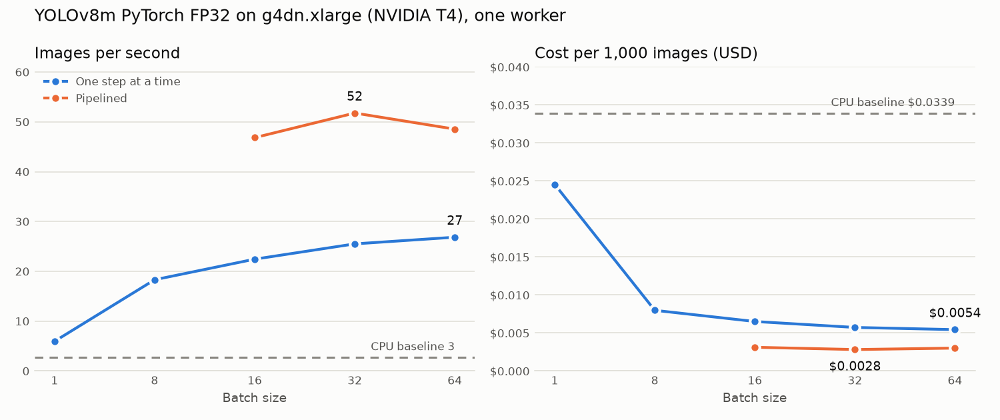
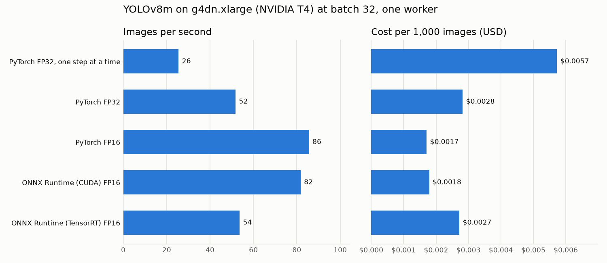

# Benchmark results

Generated by `scripts/benchmark.py report` from `benchmarks/runs/` (timed rows) and `benchmarks/evals/` (mAP). Every row is one worker on one instance, YOLOv8m on 5,000 COCO val2017 images, timed from the first message received to the last result written (instance start, image pull and model warm-up excluded). Cost counts only On-Demand instance time.

## One step at a time vs. pipelined

The rows and charts compare two ways the same worker can process a batch. Both run the same
model on the same images, so they produce the same detections and the same mAP. Only the timing
differs. Each batch goes through three steps:

- **Prepare:** receive messages from SQS, skip images that already have results, then download,
  decode and letterbox each image (on the CPU).
- **Infer:** run the model on the GPU, then postprocess (NMS, boxes back to image coordinates).
- **Finish:** write the results part file to S3, commit results and counters to DynamoDB, delete
  the messages.

**One step at a time** (`PIPELINE=0`, used for the batch-size sweep and the CPU baseline) runs
the three steps in sequence. The GPU works only during *infer*; during *prepare* and *finish* it
sits idle.

**Pipelined** (`PIPELINE=1`, the GPU service's default) runs each step in its own thread, with a
queue holding one batch between steps. While the GPU infers batch N, the CPU is already
preparing batch N+1, and batch N−1 is being written. At most three batches are in flight at
once.

**One step at a time:** the GPU (green) is busy only during each batch's *infer*.

```mermaid
---
displayMode: compact
config:
  gantt:
    leftPadding: 150
    rightPadding: 90
    fontSize: 16
    sectionFontSize: 16
    barHeight: 30
    barGap: 6
  themeCSS: '.tick text { font-size: 14px; }'
  themeVariables:
    critBkgColor: '#2e7d32'
    critBorderColor: '#1b5e20'
---
gantt
    dateFormat x
    axisFormat t+%-L
    tickInterval 2millisecond
    section Time
        begin  :milestone, 0, 0
        finish :milestone, 12, 12
    section Worker
        batch 1 · prepare :0, 2
        batch 1 · infer :crit, 2, 4
        batch 1 · finish :4, 6
        batch 2 · prepare :6, 8
        batch 2 · infer :crit, 8, 10
        batch 2 · finish :10, 12
```

**Pipelined:** each step runs in its own thread, so the GPU goes straight from one batch to the
next.

```mermaid
---
displayMode: compact
config:
  gantt:
    leftPadding: 150
    rightPadding: 90
    fontSize: 16
    sectionFontSize: 16
    barHeight: 30
    barGap: 6
  themeCSS: '.tick text { font-size: 14px; }'
  themeVariables:
    critBkgColor: '#2e7d32'
    critBorderColor: '#1b5e20'
---
gantt
    dateFormat x
    axisFormat t+%-L
    tickInterval 2millisecond
    section Time
        begin  :milestone, 0, 0
        finish :milestone, 12, 12
    section Prepare thread
        batch 1 · prepare :0, 2
        batch 2 · prepare :2, 4
        batch 3 · prepare :4, 6
        batch 4 · prepare :6, 8
        batch 5 · prepare :8, 10
        batch 6 · prepare :10, 12
    section Infer thread
        batch 1 · infer :crit, 2, 4
        batch 2 · infer :crit, 4, 6
        batch 3 · infer :crit, 6, 8
        batch 4 · infer :crit, 8, 10
        batch 5 · infer :crit, 10, 12
    section Finish thread
        batch 1 · finish :4, 6
        batch 2 · finish :6, 8
        batch 3 · finish :8, 10
        batch 4 · finish :10, 12
```

In the same time, one step at a time finishes 2 batches and the pipelined worker finishes 4,
because the GPU stays busy instead of waiting on prepare and finish.

The total time for a batch's own steps barely changes; what changes is that they overlap. A
pipelined worker's throughput is set by its slowest step, not the sum of all three, so
pipelining helps most when prepare and finish take about as long as inference.

To see whether it worked, check **Avg GPU utilization** in the results and `wait_input` in the
stage table. `wait_input` is how long the GPU sat waiting for the next prepared batch. It's only
measured in pipelined rows; in one-step-at-a-time rows that idle time is simply the prepare and
finish stages.

In the stage table, a pipelined row's stage times add up to more than its time per image,
because the stages run at the same time.

## Results

| Setup | Precision | Batch size | Images/sec | Time for N images | Cost per 1,000 images | Avg GPU utilization | mAP50-95 | Failed images |
| --- | --- | --- | --- | --- | --- | --- | --- | --- |
| ECS workers, CPU (`c6i.2xlarge`, PyTorch, unoptimized) | FP32 | 1 | 2.8 | 29 min 57 s (5,000) | $0.0339 | — | 0.5026 | 0 |
| ECS workers, GPU (`g4dn.xlarge`), PyTorch | FP32 | 1 | 6.0 | 14 min 00 s (5,000) | $0.0245 | 11% | 0.5026 | 0 |
| ECS workers, GPU (`g4dn.xlarge`), PyTorch | FP32 | 8 | 18.3 | 4 min 33 s (5,000) | $0.0080 | 39% | 0.5026 | 0 |
| ECS workers, GPU (`g4dn.xlarge`), PyTorch | FP32 | 16 | 22.4 | 3 min 43 s (5,000) | $0.0065 | 44% | 0.5026 | 0 |
| ECS workers, GPU (`g4dn.xlarge`), PyTorch | FP32 | 32 | 25.5 | 3 min 16 s (5,000) | $0.0057 | 46% | 0.5026 | 0 |
| ECS workers, GPU (`g4dn.xlarge`), PyTorch | FP32 | 64 | 26.9 | 3 min 06 s (5,000) | $0.0054 | 49% | 0.5026 | 0 |
| ECS workers, GPU (`g4dn.xlarge`), PyTorch, pipelined | FP32 | 16 | 46.8 | 1 min 47 s (5,000) | $0.0031 | 94% | 0.5026 | 0 |
| ECS workers, GPU (`g4dn.xlarge`), PyTorch, pipelined | FP32 | 32 | 51.8 | 1 min 37 s (5,000) | $0.0028 | 93% | 0.5026 | 0 |
| ECS workers, GPU (`g4dn.xlarge`), PyTorch, pipelined | FP32 | 64 | 48.5 | 1 min 43 s (5,000) | $0.0030 | 92% | 0.5026 | 0 |
| ECS workers, GPU (`g4dn.xlarge`), PyTorch, pipelined | FP16 | 32 | 85.7 | 58 s (5,000) | $0.0017 | 83% | 0.5021 | 0 |
| ECS workers, GPU (`g4dn.xlarge`), ONNX Runtime (CUDA), pipelined | FP16 | 32 | 81.8 | 1 min 01 s (5,000) | $0.0018 | 81% | 0.5021 | 0 |
| ECS workers, GPU (`g4dn.xlarge`), ONNX Runtime (TensorRT), pipelined | FP16 | 32 | 53.7 | 1 min 33 s (5,000) | $0.0027 | 28% | 0.5022 | 0 |

Best from sweep, one step at a time (lowest cost per 1,000 images, GPU PyTorch FP32): **batch size 64**.

Best from sweep, pipelined (lowest cost per 1,000 images, GPU PyTorch FP32): **batch size 32**.

## Time per image by stage (ms)

| Setup | Batch size | receive | skip_check | download | decode | load | preprocess | wait_input | inference | postprocess | write | ack |
| --- | --- | --- | --- | --- | --- | --- | --- | --- | --- | --- | --- | --- |
| CPU PyTorch FP32 | 1 | 6.5 | 3.4 | 73.1 | 2.4 | — | 1.7 | — | 215.9 | 0.7 | 49.8 | 5.2 |
| GPU PyTorch FP32 | 1 | 7.6 | 4.5 | 73.0 | 3.0 | — | 2.4 | — | 17.9 | 1.4 | 52.2 | 5.6 |
| GPU PyTorch FP32 | 8 | 1.2 | 0.6 | 13.1 | 3.4 | — | 4.4 | — | 21.1 | 1.1 | 8.8 | 0.9 |
| GPU PyTorch FP32 | 16 | 1.1 | 0.4 | 9.2 | 3.4 | — | 4.1 | — | 19.6 | 1.0 | 5.0 | 0.7 |
| GPU PyTorch FP32 | 32 | 1.1 | 0.2 | 7.5 | 3.2 | — | 4.2 | — | 18.1 | 1.0 | 3.1 | 0.7 |
| GPU PyTorch FP32 | 64 | 0.9 | 0.2 | 6.5 | 3.1 | — | 4.2 | — | 18.4 | 0.9 | 2.4 | 0.6 |
| GPU PyTorch FP32, pipelined | 16 | 1.2 | 0.4 | — | — | 11.7 | 3.8 | 0.1 | 20.0 | 1.1 | 5.4 | 1.1 |
| GPU PyTorch FP32, pipelined | 32 | 1.1 | 0.4 | — | — | 8.8 | 3.8 | 0.2 | 18.1 | 1.0 | 3.5 | 1.0 |
| GPU PyTorch FP32, pipelined | 64 | 1.2 | 0.3 | — | — | 5.8 | 3.7 | 0.2 | 19.2 | 1.1 | 2.6 | 1.1 |
| GPU PyTorch FP16, pipelined | 32 | 1.2 | 0.3 | — | — | 6.0 | 4.1 | 0.2 | 10.0 | 1.4 | 3.5 | 1.0 |
| GPU ONNX Runtime (CUDA) FP16, pipelined | 32 | 1.2 | 0.3 | — | — | 6.7 | 4.0 | 0.5 | 10.3 | 1.4 | 3.7 | 1.2 |
| GPU ONNX Runtime (TensorRT) FP16, pipelined | 32 | 1.1 | 0.3 | — | — | 13.7 | 3.5 | 11.8 | 5.4 | 1.3 | 3.1 | 1.0 |

`receive` includes waiting for SQS; `inference` is synchronized with the GPU, so it's the real compute time. In pipelined rows the stages run in parallel threads, so they add up to more than the time per image; `wait_input` is how long the GPU waited for the next batch. mAP50-95 comes from separate eval runs (confidence 0.001, multi-label, as Ultralytics validates) and is scored only where the runtime or precision changes.

## Notes

### TensorRT FP16: slower end to end than its inference suggests (open)

TensorRT has the fastest inference measured: 5.4 ms per image at batch 32, against 10 ms for PyTorch FP16. On 5,000 images it still reaches only 53.7 images/s with the GPU 28% busy. The cause is outside the model:

- **Loading slows down.** While TensorRT runs, image loading (download, decode, letterbox) takes 11–14 ms per image instead of about 6, so the GPU waits for input.
- **It isn't CPU load.** Per-thread profiles (`THREAD_PROFILE=1`) show the process using about 110% of the 4 vCPUs' 400%, less than PyTorch FP16's 190%. The loader threads are blocked, not busy.
- **Ruled out: building the engine inside the worker process.** An A/B on one instance (2026-11-12, 500 images each, `make bench-trt-ab`, `benchmarks/smoke/`) gave each run a new, empty cache folder:

  | Run | images/s | GPU busy | Load, ms/image | Engine |
  | --- | --- | --- | --- | --- |
  | A: built inside the worker | 52.8 | 40% | 12.6 | built in-process |
  | B: built in a subprocess, then loaded | 55.6 | 44% | 11.4 | loaded from cache |
  | C: PyTorch FP16 reference | 73.4 | 69% | 6.0 | – |

  B's worker built nothing (`engine_from_cache: true`) and was still slow, so the in-process build isn't the cause. The workers now build in a subprocess anyway (`TRT_PREBUILD`, on by default): it doesn't change throughput, but the startup line shows whether the engine came from the cache.
- **Still unexplained:** one earlier run reached 77.6 images/s with loading at 5.9 ms per image. Its task loaded an engine an earlier task had built and warmed up in 1.9 s. Every slow run (52.8–57.7 images/s) spent about 7.5 minutes building an engine in its task first, in-process or in a subprocess. So the slowdown may follow a build anywhere in the task, or the fast run may be an outlier. The test that would tell them apart, a run that loads a cached engine with no build in the task, wasn't run.
- **Already in place:**
  - CUDA graphs (`trt_cuda_graph_enable`) with fixed input and output buffers. mAP is unchanged at 0.5022.
  - A per-instance engine cache volume, so only the first task on an instance spends about 7.5 minutes building the engine.
  - ONNX Runtime limited to one non-spinning CPU thread.
  - The engine build in a subprocess (`TRT_PREBUILD`) and the `engine_from_cache` check.
- **Status:** left open. The report keeps the 53.7 images/s row; PyTorch FP16 remains the default.

### Other notes

- **Experiments vs. report rows:** 500-image runs (experiments, in `benchmarks/smoke/`) run slower per image than 5,000-image rows, because pipeline fill and drain weigh more. Compare them only with each other.
- **Cold starts:** ECS managed scaling launches 2 GPU instances for the first task from zero. The idle one is removed about 15 minutes later.
