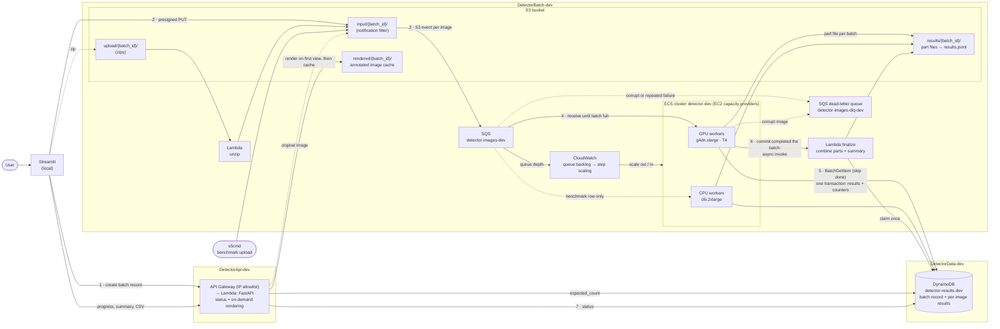
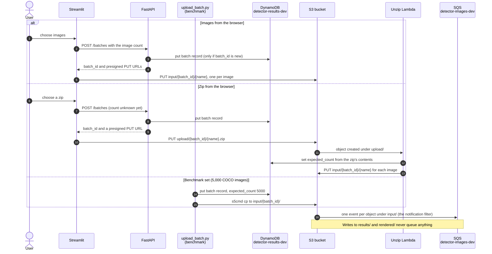
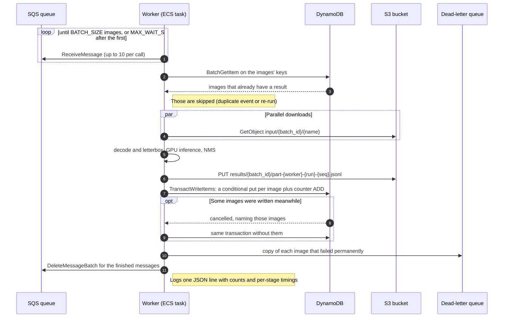
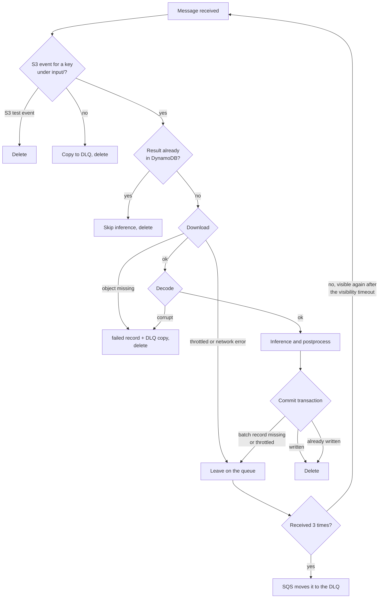
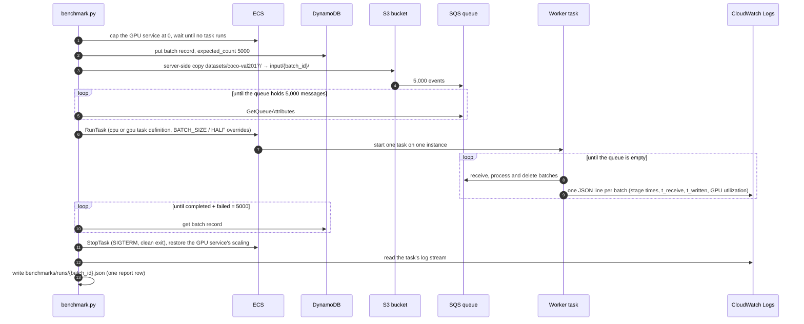

# Project: Batch Inference on AWS

Nov 4, 2026 · @Jose

## Overview

Process a large set of images as cheaply and quickly as possible on AWS. Images land in S3, queue up in SQS, and workers on ECS run them through YOLOv8m in batches, writing results to S3 and DynamoDB. The project is about throughput, cost and reliability for bulk work, not per-request latency.

It's one project in a self-directed ML platform engineering roadmap.

**Goals**

- **Find the best batch size:** the batch size on a T4 GPU (`g4dn.xlarge`) that gives the most images per second and the lowest cost per 1,000 images, and whether gains flatten out by batch size 64.
- **Quantify GPU vs. CPU for bulk work:** how much cheaper and faster a 5,000-image job is on a GPU worker than on an unoptimized CPU worker of similar hourly price.
- **Measure optimized runtimes:** what FP16, ONNX Runtime and TensorRT add on top of batching, without losing accuracy.
- **Build a pipeline you'd trust in production:** it scales with queue depth, isolates bad images in a dead-letter queue, and can be re-run without processing any image twice.

**What the results will show**

- **Throughput and cost by batch size:** the headline chart, with GPU utilization explaining where the curve flattens.
- **Where the time goes:** decode, preprocess, inference and postprocess time per batch, showing whether CPU-side preprocessing becomes the bottleneck as batches grow.
- **GPU vs. CPU:** cost per 1,000 images and total job time for the full COCO validation set.
- **Runtime gains:** the improvement from FP16, ONNX Runtime and TensorRT at the best batch size, with mAP50-95 confirming accuracy is unchanged.
- **Operations:** how long workers take to scale up, how long the queue takes to drain, how many bad images the dead-letter queue caught, and proof that a re-run skips finished images.

**What it doesn't measure:** per-request latency for real-time traffic. Workers are kept fully busy, so cost per 1,000 images here reflects bulk processing, not a service that sits partly idle between requests.

**Skills used**

- **ML inference and optimization:** batched GPU inference with PyTorch, FP16, ONNX export and ONNX Runtime with the CUDA and TensorRT execution providers, mAP50-95 evaluation on COCO, finding preprocessing bottlenecks.
- **Distributed and event-driven systems:** S3 event notifications, SQS queues and dead-letter queues, batching messages into GPU-sized work, per-message failure handling, completion tracking, idempotent re-runs.
- **Containers and compute:** ECS on EC2 with a capacity provider, GPU instances (`g4dn.xlarge`), Docker images with CUDA, autoscaling on queue depth.
- **Infrastructure as code and delivery:** AWS CDK in Python, GitHub Actions CI/CD authenticating to AWS through OIDC federation and IAM role assumption, with no stored access keys.
- **Data and APIs:** DynamoDB transactions with conditional writes for exactly-once counting, results files in S3, a FastAPI service for batch status and on-demand rendering with an S3 cache, a Streamlit front end.
- **Performance and cost engineering:** throughput benchmarking, per-stage timing, GPU utilization analysis, cost per 1,000 images.
- **Image processing and systems programming (stretch):** OpenCV preprocessing, parallel decoding, a C++ client with ONNX Runtime.

| Layer | Tools |
| --- | --- |
| Model | Ultralytics YOLOv8m, pretrained on COCO |
| Ingest | S3 events, SQS, dead-letter queue |
| Workers | ECS on EC2 through a capacity provider, On-Demand instances: `g4dn.xlarge` (NVIDIA T4) for GPU, one pinned instance type for CPU (for example `c6i.2xlarge`, chosen for a similar hourly price) |
| Optimized runtime | FP16 in PyTorch; ONNX Runtime with the CUDA and TensorRT execution providers |
| Storage | S3 (input images, per-worker result part files, combined results file), DynamoDB (per-image results, per-batch status record) |
| Status API | FastAPI on Lambda (container image, arm64) behind an API Gateway REST API that only accepts requests from an IP allowlist: `GET /batches/{batch_id}` for status, plus on-demand rendering of annotated images |
| Front end | Streamlit, run locally against the API |
| Infrastructure | AWS CDK in Python (`DetectorData`, `DetectorBatch` and `DetectorApi` stacks) |
| CI/CD | GitHub Actions, authenticated to AWS with OIDC (no stored access keys) |

## Data

- **Benchmark set:** the COCO 2017 validation split (5,000 labeled images). Upload it once with s5cmd to `datasets/coco-val2017/`, which is outside `input/` and so queues nothing. Each benchmark run then copies it server-side into `input/{batch_id}/`; the copy takes seconds and doesn't depend on the uploader's connection.
- **Annotations:** `instances_val2017.json` from COCO's annotation download, used only to score mAP50-95. No labeling is needed.
- **Failure test images:** a handful of deliberately corrupt files mixed into one run to exercise retries and the dead-letter queue.

A download-and-upload script in the repo fetches the images (http://images.cocodataset.org/zips/val2017.zip, about 1 GB) and annotations (http://images.cocodataset.org/annotations/annotations\_trainval2017.zip), then copies them to S3. Run it from an EC2 instance in the same region as your bucket; it's much faster than from home.

## Architecture



**How to read it:** the numbers follow one batch through the pipeline below. Solid lines are the normal path and dotted lines are the side paths (zip uploads, failures, the source image for rendering). The bucket and queue share `DetectorBatch-dev` so S3 can notify SQS directly, and the unzip and finalize functions live there too (S3 notifies one, the workers invoke the other); the table sits in `DetectorData-dev`, which deploys first, and the API in `DetectorApi-dev`, which deploys last. GPU and CPU workers run the same code and write the same way; only the instance type and runtime differ.

## Workflows

The architecture diagram shows what exists; these diagrams show the order things happen in for the main flows. The pipeline steps below give the details.

### Upload a batch

The batch record always comes first: without `expected_count` there's no percent complete and no way to tell when the batch is done. The worker refuses to commit results for a batch that has no record (the messages wait on the queue until it exists).



### Process one batch (worker)

Each worker loops over this sequence. A message is deleted only after every image it names is committed, already done, or has failed permanently.

The sequence has three steps:
- **prepare:** receive, skip check, then download, decode and letterbox in a thread pool;
- **infer:** inference and postprocess;
- **finish:** part file, transaction, dead-letter copies and deletes.

The CPU worker runs them one after another. The GPU worker runs them **pipelined**, in three threads joined by one-slot queues: while the GPU infers batch N, batch N+1 is being prepared and batch N−1 written. That's at most three batches in flight, well inside the 5-minute visibility timeout. The FP32 sweep showed why this matters: one step at a time, the T4 was busy only about half of each batch.

If any step fails, that batch's messages stay on the queue for SQS to retry. The pipeline continues with the next batch. On SIGTERM, collection stops and the batches in flight are finished.



### Failure handling

Every image ends in one of three places: a result in DynamoDB, a `failed` record (permanent problems, also copied to the DLQ), or back on the queue for SQS to retry.



### Completion, status and on-demand rendering

**Finalize trigger:** after each commit that wrote results, the worker reads the batch record (one consistent `GetItem`). If `completed + failed` has reached `expected_count` and the status is still `pending`, it invokes the finalize Lambda function asynchronously (`InvocationType=Event`) and moves on, so the GPU path never waits for it. Several workers can see the same batch complete; `GET /batches/{batch_id}` also invokes finalize as a safety net when a complete batch is still `pending` (for example, if the invoke failed). Whatever starts it, the conditional claim (`pending` → `finalizing`) lets exactly one run proceed; a claim older than 15 minutes, from a run that crashed, can be taken again.

**Unknown counts:** a zip batch is created without `expected_count`. The unzip function counts the images in the zip and sets it, conditionally and only once, before writing any image to `input/`, so the batch can't look complete early. A zip it can't read, or one over the limits (10,000 images, 8 GB uncompressed), marks the batch `rejected`.

**Access:** API Gateway's resource policy allows `execute-api:Invoke` only from `api_allowed_cidrs`; everything else gets 403 before the function runs. There's no other authentication, so anyone behind an allowed IP can use the API (a known trade-off for a single-user demo; IAM auth with SigV4-signed requests is the upgrade). The Streamlit app holds no AWS credentials: uploads and downloads use presigned URLs, valid for an hour, that the API's role signs.

```mermaid
sequenceDiagram
    autonumber
    actor User
    participant UI as Streamlit
    participant API as FastAPI
    participant DDB as DynamoDB
    participant W as Worker
    participant F as Finalize (Lambda)
    participant S3 as S3 bucket

    loop every few seconds while running
        UI->>API: GET /batches/{batch_id}
        API->>DDB: get batch record
        API-->>UI: (completed + failed) / expected_count
    end
    W->>DDB: commit; completed + failed reaches expected_count
    W-)F: invoke asynchronously
    F->>DDB: status pending to finalizing (conditional, so it runs once)
    F->>S3: read results/{batch_id}/part-*.jsonl
    F->>S3: PUT results.jsonl (one line per image) and summary.json
    F->>DDB: status done, with a few summary fields
    UI->>API: GET /batches/{batch_id}
    API-->>UI: done, summary and CSV link

    User->>UI: open one image
    UI->>API: GET /batches/{batch_id}/images/{image_id}/annotated
    API->>S3: HEAD rendered/{batch_id}/{image_id}
    alt Already rendered
        API-->>UI: presigned URL to the cached copy
    else First view
        API->>S3: GET input/{batch_id}/{image_id}
        API->>DDB: get the image's detections
        API->>API: draw boxes
        API->>S3: PUT rendered/{batch_id}/{image_id}
        API-->>UI: presigned URL
    end
```

### One benchmark run (one row of the report)

The queue is filled before any worker starts, and exactly one worker runs, so the row measures the setup rather than upload speed or worker count. The worker is a standalone task (ECS RunTask) rather than the service scaled to 1. The task takes `BATCH_SIZE` and `HALF` as environment overrides, so every sweep row uses the same task definition, and nothing has to be redeployed between rows. The GPU service is capped at 0 for the run so it can't start a second worker.



## Pipeline

Many images in, one report out.

1. **Upload:** before any image is uploaded, create a batch record in DynamoDB with `batch_id`, `expected_count` and a `completed` counter set to 0; without a known total there's no percent complete and no way to tell when a batch is done. Streamlit then requests S3 presigned URLs and uploads the images straight to `input/{batch_id}/`. A zip goes to `upload/{batch_id}/` instead, where a small Lambda function extracts it into `input/` and sets `expected_count` from the zip's contents. For the full COCO validation set, use s5cmd and write the record from the upload script.
2. **Trigger:** an S3 event puts each image on an SQS queue. The bucket keeps one top-level prefix per purpose (`input/`, `upload/`, `results/`, `rendered/`, each followed by `{batch_id}/`, plus `datasets/` for the staged benchmark set), and the notification filters on `input/`, so the files workers and the API write never queue messages of their own. Workers run on ECS: GPU workers on EC2 instances through a capacity provider, since Fargate has no GPU, and CPU workers on one pinned instance type. **The GPU service owns the queue:** it is the only service that scales on the backlog. The CPU workers have a service with no scaling (always 0) and run only as the CPU benchmark row's task, so an upload never pays for two instance types. GPU worker count scales on the queue backlog (visible plus in-flight messages, so a busy worker isn't removed while it holds messages) with step scaling: no backlog for 5 minutes → 0 workers, any backlog → 1, 2,000 or more → the configured maximum. Target tracking on backlog per task was the first idea, but it can't start a service from 0 tasks, and step scaling gives the same result at these sizes. The capacity provider then adds or removes EC2 instances to fit the tasks, and its managed termination protection stops an instance from being terminated while it still runs a task. From 0 instances, ECS managed scaling launches 2 instances for the first task (its reservation metric reads 200% while a task waits for capacity, and capping the scaling step to 1 doesn't change that). The idle one is removed about 15 minutes later, which costs about $0.13 per GPU cold start; it isn't worth replacing managed scaling, which the termination protection depends on. Expect scaling to react about a minute late, since SQS metrics in CloudWatch lag. **Network:** public subnets with no NAT gateway (it would cost about $32 a month even when idle). Instances accept no inbound traffic. S3 and DynamoDB traffic goes through free gateway endpoints, and SQS, ECR and CloudWatch Logs through the internet gateway. Starting a GPU worker from zero means launching an instance and pulling a CUDA image several GB in size, which takes minutes, so use the ECS GPU-optimized AMI and keep the image small.
3. **Inference:** each worker collects messages into a batch of the configured size (1, 8, 16, 32 or 64) before calling the GPU. SQS returns at most 10 messages per receive, so the worker long-polls until the batch is full or a short wait (for example 1 second) runs out. Set the queue's visibility timeout well above the time it takes to collect, run and write the largest batch, so messages don't reappear while they're still being processed. Before inference, the worker calls `BatchGetItem` on the batch's image keys and drops images that are already done, since S3 can deliver an event more than once and re-runs send every image again. Preprocessing (decode and a fixed 640×640 letterbox with `cv2.copyMakeBorder`) and postprocessing live in one `inference_core.py` module that every runtime calls, rather than `model.predict()`, which preprocesses internally. Every setup in the report uses identical code.
4. **Per-message failure handling:** each image is decoded in its own `try`/`except`, so one corrupt file doesn't fail the other 31 messages in its batch. Images that decode run through the model; their messages are deleted with `DeleteMessageBatch` (at most 10 per call) after their results are saved. A corrupt file fails the same way on every attempt, so the worker doesn't wait for retries: it writes a `failed` record with the error and sends the message to the dead-letter queue right away. Errors that may be temporary (throttling, timeouts) leave the message on the queue to be retried, with `maxReceiveCount` set to 3.
5. **Save:** per-image results and the batch's counters are committed together in one DynamoDB `TransactWriteItems` call per GPU batch (up to 99 images plus the counter update, under the 100-action limit). Each image is a conditional put that succeeds only if that image has no result yet, and the counter update adds exactly the number of images the transaction wrote. If some images were already written (a duplicate S3 event, or a retry after a crash), the transaction is cancelled with those items named, and the worker drops them and commits the rest. So no image is ever counted twice or left uncounted, which the original plan of `BatchWriteItem` followed by a separate `UpdateItem ADD` couldn't guarantee: a crash between the two calls would leave the batch short of complete forever. Transactions cost twice the write units, which is still a few cents for 5,000 images. Several workers can't append to one S3 object, so before committing, each worker writes one part file per GPU batch to `results/{batch_id}/part-{worker_id}-{run}-{seq}.jsonl`. The run token stops a restarted worker from overwriting its earlier files. Workers never draw or upload annotated images, so GPU time goes only to inference.
6. **On-demand rendering:** annotated images are created only when someone asks for one. `GET /batches/{batch_id}/images/{image_id}/annotated` on the FastAPI service first checks for a cached copy in `rendered/{batch_id}/`. If there isn't one, it loads the original image from S3 and its detections from DynamoDB, draws the boxes, saves the result there, and returns a presigned URL. Most images in a 5,000-image job are never viewed, so most are never rendered.
7. **Completion and report:** `GET /batches/{batch_id}` returns status and percent complete (`(completed + failed) ÷ expected_count`). When every image is accounted for, a finalize step runs once (guarded by a conditional update on the batch record's status) that combines the part files into one results file (`results.jsonl`), keeping one line per image, since a crash between writing a part file and committing can leave the same image in two part files, and generates a summary: images processed, detections per class, average confidence, failures, total time and cost. Streamlit shows a progress bar, summary charts and a CSV download.
8. **Reliability:** retries for temporary errors, a dead-letter queue for corrupt images and messages that keep failing, and idempotent processing so a re-run skips finished images.
9. **Optimize:** first pipeline the worker (see *Process one batch*), then, at the best batch size, run the optimized-runtime rows in the report:
   - FP16 in PyTorch;
   - ONNX Runtime's CUDA execution provider, with an FP16 copy of the model exported straight from PyTorch (`docker/export_fp16.py`; float32 inputs and outputs). `onnxconverter-common` produced a graph ONNX Runtime refused to load;
   - ONNX Runtime's TensorRT execution provider, building an FP16 engine from the FP32 model.

   **The ONNX models are exported during the GPU image build** (`onnx` has no macOS wheel for Python 3.14). The export uses Ultralytics with a dynamic batch dimension and is simplified with onnxslim.

   **Versions:** ONNX Runtime 1.31 is built against CUDA 13 and TensorRT 10.14, so the image installs `tensorrt-cu13-libs==10.14.1.48` from NVIDIA's index. TensorRT 11 wouldn't load.

   **TensorRT engine:** it's built at task start for a batch range from 1 to `BATCH_SIZE`. That takes minutes on a T4 and is logged as `warmup_s`; it's excluded from the row's timing, like the rest of startup.

   **Data path:** with every runtime, input and output stay on the GPU (ONNX Runtime IO binding to torch CUDA tensors), and the same postprocess and NMS run, so only the model execution differs between rows.

The bucket, table, queue, workers, capacity provider and scaling are defined in one AWS CDK (Python) app, with the pipeline in a `DetectorBatch` stack.

## CI/CD with GitHub Actions

GitHub Actions builds, tests and deploys the CDK app. It signs in to AWS through OIDC federation: each workflow run gets a short-lived token from GitHub, exchanges it for temporary credentials by assuming an IAM role, and never stores AWS access keys as secrets.

**How the OIDC setup works** (`DetectorCi-<env>`, `infra/stacks/ci.py`, deployed locally once with `make deploy-ci`; CI never deploys its own roles)

- **Identity provider:** the account already has an IAM OIDC provider for `token.actions.githubusercontent.com` with audience `sts.amazonaws.com`, and an account can have only one per URL, so the stack imports it.
- **Deploy role** (`detector-gh-deploy-<env>`): its trust policy allows `sts:AssumeRoleWithWebIdentity` only when the token's `aud` is `sts.amazonaws.com` and its `sub` is exactly `repo:<github_repo>:environment:dev`, the subject GitHub gives a job that runs in the `dev` environment. The environment's *deployment branches* setting allows only `develop`, so a job on another branch can't enter it, and tokens from forks or other repos are rejected. There's no `main` branch: develop is the deployed branch.
- **Read-only role for pull requests** (`detector-gh-pr-<env>`): trusted only for pull-request runs (`sub` is `repo:<github_repo>:pull_request`). It may assume only the CDK bootstrap **lookup** role, enough for `cdk diff --method template` to read the deployed stacks, so untested code can never publish or deploy anything.
- **Benchmark role:** deferred. Benchmarks still run locally (`make bench`), and their run files are committed with the code.
- **Least privilege:** the deploy role may only assume the four CDK bootstrap roles (deploy, file publishing, image publishing and lookup). CloudFormation does the actual work through them.
- **Workflow settings:** only the jobs that call AWS get `id-token: write`; everything else has `contents: read`. `aws-actions/configure-aws-credentials` takes the role ARN, the region and a role session name with the run ID (`gh-deploy-<run_id>`, `gh-pr-<run_id>`), so CloudTrail shows exactly which run made each change.
- **Config:** `infra/environments.conf.json` is gitignored, so CI writes it from the `ENVIRONMENTS_CONF_JSON` repository secret; `github_repo` in it names the only repository the roles trust.

**Pipeline stages** (`.github/workflows/`)

1. **Checks** (`checks.yml`, reused by the other two): lint (`ruff check`, `ruff format --check`), the unit tests (the fast suite, with a pass/fail summary and the JUnit file as an artifact), and `cdk synth`. No AWS access.
2. **Pull request into develop** (`ci.yml`): the checks, then `cdk diff --method template` with the read-only role, posted as one PR comment that's updated on each push.
3. **Merge into develop** (`deploy.yml`): a gate job deploys only commits that came from a merged pull request (the commit is the PR's merge commit); a direct push to develop runs the checks and stops. Then `cdk deploy` of the data, batch and API stacks with the deploy role. Images are built on the runner and pushed straight to ECR with `docker buildx build --push` (`scripts/ci_publish_images.py`, driven by the synthesized asset manifests), since loading the GPU image locally first, as `cdk deploy` would, needs about 45–50 GB of disk, and a standard runner has about 40 GB after cleanup. `cdk deploy` then finds every image already in ECR. With `-c ci_cache=1`, each image pulls unchanged layers from its tag (`gpu`, `cpu`, `api`) in the `detector-build-cache-<env>` ECR repo instead of rebuilding them. That repo is in `DetectorCi-<env>`, with mutable tags (the CDK assets repo's tags are immutable, so a cache there could be written only once), and its repository policy lets the image-publishing role read and write it, and an image whose hash-named tag is already in ECR isn't built at all. Deploys queue rather than overlap, and they never start workers: the services stay at 0 tasks until images arrive in `input/`.
4. **Environment `dev`:** the deploy job runs in it, which is what the deploy role trusts. Its deployment-branch rule (develop only) and the gate job together mean only merged PRs deploy. Required reviewers can be added to it later to approve each deploy, without code changes.
5. **Benchmark run:** deferred, as above.

**Why it matters:** no long-lived keys to leak or rotate, every deployment traceable to a specific commit and run, and pull requests that can't change infrastructure.

## Benchmark report

Every row uses YOLOv8m on the full COCO validation set (5,000 images), following these rules so the rows are comparable:

- **One worker on one instance per row,** so images per second reflects the setup, not how many workers ran. Scaling is measured separately below.
- **Queue filled first:** upload all 5,000 images and wait until the queue holds every message before starting the worker. Otherwise a fast GPU worker drains the queue faster than images arrive, and the row measures upload speed instead of the setup.
- **Timing:** from the first message received to the last result written, excluding instance and worker startup. GPU calls return before the work finishes, so call `torch.cuda.synchronize()` before stopping the inference timer; otherwise inference time looks too short and postprocessing too long.
- **Precision:** state it for every row. Rows are FP32 unless marked FP16.
- **GPU utilization:** the worker samples NVML every 500 ms, the same counter `nvidia-smi --query-gpu=utilization.gpu` reports, from inside the container. Each batch log line carries the mean over that batch, and the report uses the sample-weighted mean for the whole run.
- **Cost per 1,000 images:** On-Demand instance hourly price × measured run time ÷ images processed × 1,000. This counts only instance time; S3, SQS and DynamoDB charges for a 5,000-image job are a few cents and are left out.

| Setup | Precision | Batch size | Images/sec | Time for 5,000 images | Cost per 1,000 images | Avg GPU utilization | mAP50-95 | Failed images |
| --- | --- | --- | --- | --- | --- | --- | --- | --- |
| ECS workers, CPU (`c6i.2xlarge`, PyTorch, unoptimized) | FP32 | 1 |  |  |  | — |  |  |
| ECS workers, GPU | FP32 | 1 |  |  |  |  | — |  |
| ECS workers, GPU | FP32 | 8 |  |  |  |  | — |  |
| ECS workers, GPU | FP32 | 16 |  |  |  |  | — |  |
| ECS workers, GPU | FP32 | 32 |  |  |  |  | — |  |
| ECS workers, GPU | FP32 | 64 |  |  |  |  | — |  |
| ECS workers, GPU, PyTorch | FP16 | best from sweep |  |  |  |  |  |  |
| ECS workers, GPU, ONNX Runtime (CUDA EP) | FP16 | best from sweep |  |  |  |  |  |  |
| ECS workers, GPU, ONNX Runtime (TensorRT EP) | FP16 | best from sweep |  |  |  |  |  |  |

*Best from sweep* means the batch size with the lowest cost per 1,000 images in the five FP32 GPU rows above. Replace it with the actual number once the sweep is done. The CPU row is a deliberately unoptimized baseline on an instance with a similar hourly price to `g4dn.xlarge`; say so wherever the GPU vs. CPU number is quoted.

- **Headline chart:** images per second and cost per 1,000 images by batch size, showing whether gains flatten out by batch size 64.
- **Time split per batch:** record decode, preprocess, inference and postprocess time for each batch, and show the split for every row, so it's clear where time goes as batch size grows. `g4dn.xlarge` has only 4 vCPUs, so low GPU utilization at batch sizes 32 and 64 usually means the CPU side is the bottleneck.
- **Scaling:** time from the first upload until all workers are running, and time to drain the queue.
- **Reliability:** include a few corrupt images on purpose; report retries, dead-letter queue count, and that a re-run skips finished images.
- **Accuracy:** score mAP50-95 with evaluation settings (confidence threshold 0.001, multi-label, as Ultralytics uses), not the pipeline's production threshold (for example 0.25), which would make mAP look lower.
  - **How:** `benchmark.py run --eval` processes the 5,000 images on AWS with those settings (`CONF`, `MULTI_LABEL` overrides). Its part files are then scored locally against the COCO annotations with pycocotools. This way the GPU-only runtimes are scored on the same worker code as their timed rows.
  - **Where results go:** eval runs aren't timed rows. Their results go to `benchmarks/evals/` and fill the mAP column of every row with the same runtime and precision. Score it only where the model, runtime or precision changes: PyTorch FP32 (once, for every FP32 row including the CPU baseline's model), and each optimized runtime. Every image is letterboxed to a fixed 640×640 and pipelining doesn't change the computation, so batch size and worker mode can't change the output: a sweep row shows the mAP of its runtime and precision rather than a separate score. The FP32 baseline should land near the published YOLOv8m value of about 50.2.
- **Hardware consistency:** GPU rows run on `g4dn.xlarge` (NVIDIA T4). Fargate's CPU generation varies between tasks, so run the CPU row on EC2 with a pinned instance type.

**Results so far** (full table and charts in [benchmark.md](benchmark.md)):
- **Batch size,** one step at a time: 6 → 27 images/s from batch 1 to 64, with the GPU at most 49% busy.
- **Pipelining:** PyTorch FP32 doubles to 52 images/s at batch 32, with the GPU 93% busy.
- **FP16** is the best setup: PyTorch FP16 at batch 32 runs 86 images/s for $0.0017 per 1,000 images, with mAP50-95 0.5021 against 0.5026 in FP32. It's the GPU service's default.
- **ONNX Runtime CUDA FP16** lands within 5% of PyTorch FP16.
- **TensorRT FP16 is an open issue:** it has the fastest inference (5.4 ms per image), but image loading slows twice over while it runs, with the CPU mostly idle, so it reaches only 54 images/s.
  - **Ruled out:** building the engine in the worker process. An A/B with the engine built in a subprocess and loaded from the cache was just as slow (56 vs. 53 images/s).
  - **Unexplained:** one run that loaded a cached engine, with no build in its task, reached 78 images/s (see the notes in [benchmark.md](benchmark.md#notes)).
- **Against the CPU baseline,** the best GPU setup is about 30× faster and 20× cheaper per image.

**Skills shown:** event-driven and asynchronous processing, queues, batching, throughput and cost optimization, failure handling.

## Stretch goals: OpenCV preprocessing enhancements

At larger batch sizes, decoding and resizing images on the CPU often becomes the bottleneck before the GPU does.

The fixed 640×640 letterbox in `inference_core.py` is part of the core pipeline, not a stretch goal; these goals make it faster.

- **Faster decoding:** decode and resize images in parallel threads, or in a separate loader process while the GPU works on the previous batch, and add the throughput gain as one optimization row in the report.

Keep these functions in a shared, unit-tested OpenCV utilities module; OpenCV's C++ API is nearly identical, so the same steps carry over to the C++ client.

## C++ optimization

- Write a C++ inference client that loads the ONNX export of YOLOv8m with ONNX Runtime's C++ API and preprocesses images with OpenCV.
- Benchmark it on the batch job and add its throughput to the report.
- Build it with CMake, test with GoogleTest, and ship it in a multi-stage Docker image.

## Portfolio deliverable

A GitHub repo with the architecture diagram, a one-command `cdk deploy`, and the benchmark report: throughput and cost by batch size, CPU vs. GPU workers, and PyTorch FP32 vs. FP16 vs. ONNX Runtime vs. TensorRT vs. C++.

## Showcase

- **GitHub README:** architecture diagram, demo GIF of the Streamlit batch page, the results table and deploy instructions at the top.
- **Blog post (short):** what batching buys you on a GPU: throughput and cost per 1,000 images by batch size, plus FP16, ONNX Runtime, TensorRT and C++. Publish on your own blog, then cross-post to Medium or dev.to.
- **LinkedIn post:** the problem, one headline number, the chart and links; tag the tools you used.
- **Video (2–3 minutes):** a screen recording with voiceover, made after the benchmark so it uses real numbers; outline below.

**Video outline**

1. **The problem and the architecture (about 20 seconds):** "running detection on thousands of images, as cheaply as possible." Show the architecture diagram and trace one image through it.
2. **A live run (about 60 seconds):** start a 5,000-image upload, then show the SQS queue depth climbing in CloudWatch, ECS GPU workers scaling up, GPU utilization rising and the Streamlit progress bar filling. Speed up the waiting parts so the job fits in a few seconds.
3. **On-demand rendering (about 20 seconds):** click an image in the Streamlit results; the annotated version appears after a short delay, then instantly on the second click because it's cached. Point out that most images never need rendering.
4. **Reliability (about 20 seconds):** show the corrupt test images landing in the dead-letter queue, then a re-run skipping finished images.
5. **Results (about 30 seconds):** the throughput and cost chart by batch size, where gains flatten out, the FP16, ONNX Runtime and TensorRT improvements, and one headline number, such as cost per 1,000 images on GPU vs. CPU.
6. **CI/CD (about 10 seconds, optional):** merge a pull request and show GitHub Actions deploying to AWS through OIDC, with no stored keys.

Record with OBS or Loom at 1080p and add captions, since many people watch LinkedIn videos muted. Cut a 60-second version for LinkedIn (steps 2, 3 and 5) and keep the full version for the README and YouTube.
